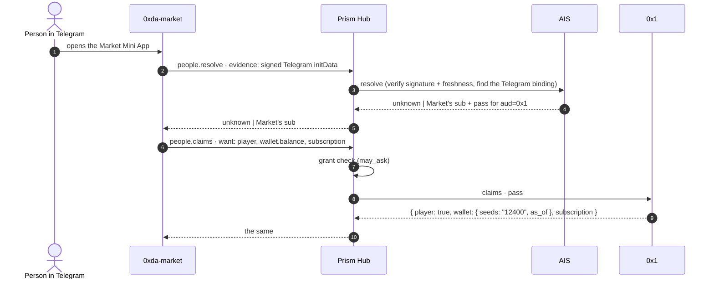
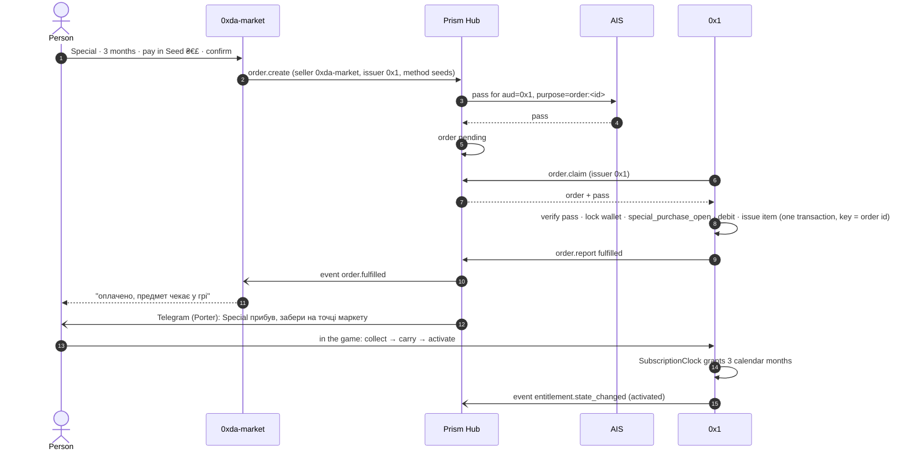

# hub.v1: how the aiaiaiai family works through Prism Hub

Status: proposed. Nothing here is deployed. Where a part already exists in
code, the section names it.
Scope: one parent, aiaiaiai, and its products, the **family**: 0x1
(`nilx-one/*`), 0xda-market (`0xda-market/*`), Prism, and the ones that come
later. AIS (`aiaiaiai-org/4x-ais`) is the family's identity.

## Decisions

Owner decisions, 2026-11-11:

1. The protocol is **`hub.v1`**. "Family" is the name for the set of products.
2. **Prism Hub orchestrates the family.** Every product-to-product request
   and every event goes through it.
3. The **person pass** (below) needs no consent screen: confirming the
   purchase is consent enough.
4. **Many products take real money**, not only 0xda-market: App Store and
   Google Play purchases inside the apps, later others.
5. **One identifier per product**, the same everywhere: `0x1`, not `0x1` in
   one place and `nilx-one` in another.

Owner decision, 2026-11-12:

6. **No refund after activation.** Once an entitlement is `activated`, the
   order is final ([refunds](#refunds)).
7. **A store refund after activation removes the status, nothing more**
   (2026-11-12). No ban, no account penalty.

## Who owns what

| Who          | Owns                                                                                       | Never owns                  |
| ------------ | ------------------------------------------------------------------------------------------ | --------------------------- |
| AIS          | people, `pub_dress`, password, sessions, provider bindings (Telegram, …), pairwise `sub`, tokens for people and products, person passes | money, items, product state |
| Prism Hub    | the product registry and its grants, routing of requests, the life of every cross-product order, event fan-out, telling people (Porter → Telegram and other channels) | balances, debits, catalogs, game state |
| 0x1          | the Bond, the Avaia, the **Seed ₴€£ wallet**, inventory, the subscription clock, what a paid thing becomes in the game | prices, offers, checkout    |
| 0xda-market  | catalog, categories, SKUs, prices, quotes, its checkout and payment providers             | balances it does not issue  |
| App stores   | the in-app payment and its signed transaction (reached through the product whose app sold) | everything else             |

A currency belongs to the product that issues it. Seeds are issued by 0x1, so
only 0x1 debits or credits them.

## The rules

1. **One fact, one owner.** Only the owner writes a fact; everyone else asks.
2. **Hub orchestrates, the owner commits.** The hub decides what happens next
   and to whom; a debit and what it pays for are still one transaction inside
   the owner of the money. The hub never holds a balance and never takes part
   in that transaction.
3. **A hub outage delays, it never loses or doubles.** Requests carry an
   idempotency key end to end (the order id). Events are kept in an outbox
   until delivered. A repeat confirms the first result.
4. **Navigation is never proof.** A browser coming back with an order id
   proves nothing; only an authenticated answer from the owner does.
5. **Pairwise subjects.** Each product knows a person only by its own `sub`.
   Only AIS can say that two products' `sub`s are the same person, and only
   for one operation at a time (the person pass).
6. **Proof the person is here.** Nobody asks about a person by a bare
   identifier (a Telegram id, a `pub_dress`). Otherwise any product could ask
   "is Telegram 123 a person, a player, how rich" about everybody.
7. **No shared databases or cookies.** HTTPS through the hub, and events.
8. **`hub.v1` only grows.** A breaking change is `hub.v2`, run in parallel
   until every product has moved.

## Credentials

- **People** sign in only through AIS: OIDC code + PKCE, pairwise `sub`, EdDSA
  `id_token`. 0x1 does this today; 0xda-market and Prism follow (`cell` skin for
  0x-products, `slug` for the rest).
- **Products** prove who they are with an AIS token: `client_credentials`
  with `private_key_jwt` (each product signs with its own Ed25519 key; no shared
  secrets), `aud=prism-hub`, `exp` ≤ 5 minutes.
- **The hub** verifies the token, finds the product's `ServicePrincipal` and
  checks its grants (the capability-grant model Hub already has, extended
  from channels to products). It forwards a request with its own AIS token,
  `aud=<target product>`, and an `act` claim naming the product that asked.
  The target trusts the hub and still knows who is asking.

This replaces per-pair secrets, such as the HMAC handoff between 0x1 and
0xda-market today (`nilx-one/core` `market_issuer`); that keeps working until
the move.

## The registry and grants

A product's entry in the hub:

```json
{
  "product": "0xda-market",
  "ais_client_id": "0xda-market",
  "events_uri": "https://0xda-market.nilx.one/hub/events",
  "issues": [],
  "takes_money": ["market_psp"],
  "may_ask": { "0x1": ["player", "wallet.balance", "subscription"] },
  "may_order_from": ["0x1"],
  "subscribes": ["identity.*", "order.*", "entitlement.*"]
}
```

- `issues`: currencies the product is authority for (`0x1`: `["seeds"]`).
- `takes_money`: payment methods it may report as paid (`0x1`: `["app_store",
  "google_play"]`).
- `may_ask`: which claims about a person it may ask of which product.
- `may_order_from`: which issuers it may place orders with.

Nothing listed, nothing allowed. A new product is one entry.

## The person pass

What it is, plainly: when 0xda-market has to tell 0x1 *who* is buying, it
cannot say "0x1's user N", because Market only knows its own name for the
person. AIS gives a **pass**: a short signed note that says "for this one
operation, this person is 0x1's `sub` X", sealed so that only 0x1 reads it.

| Claim     | Value                                                    |
| --------- | -------------------------------------------------------- |
| `iss`     | `https://auth.aiaiaiai.org`                              |
| `aud`     | the product that will act (`0x1`)                        |
| `sub`     | the person's pairwise `sub` **for that product**         |
| `azp`     | the product that asked (`0xda-market`)                   |
| `purpose` | `claims` or `order:<order id>`                           |
| `exp`     | 15 minutes                                               |
| `jti`     | unique; accepted once                                    |

Market cannot reuse it or read anything from it; the hub carries it but does
not need it. It replaces `pub_dress` as the join key, which breaks on a rename
or a prefix change.

## Asking about a person

### Market first (Telegram)



- Evidence is Telegram's signed `initData` or a Telegram login payload, never
  an id. AIS checks it with Telegram's third-party validation (Telegram's
  public-key signature over `initData`), so it never holds Market's bot token.
  The exact verification is to be confirmed against Telegram's current
  documentation before it is built.
- `unknown` means no aiaiaiai identity holds this Telegram account. Market can
  send the person to AIS to sign in or create one.
- **The wallet is read, never handed over.** `wallet.balance` is a snapshot for
  drawing prices. Seeds are spent only by an order 0x1 commits itself.

Exists in part: Market already takes orders in Telegram, and 0x1 checks that
the ordering Telegram account is still bound to the paying Bond
(`SpendAuthorization::ProviderLink`).

### 0x1 first (`0xda-market.nilx.one/zoloti`)

1. A player taps through from the game. 0x1 opens a visit (exists:
   `market_visit`) and asks the hub for a pass `aud=0xda-market`.
2. The one-time handoff code carries the pass, the context (Market point,
   issuer `0x1`, the page to return to) and the claims granted for this visit.
3. Market answers with its catalog for that context: categories, SKUs, prices.
4. A purchase is an order like any other. The return to the game is confirmed
   by the order's state in the hub, not by the navigation (exists today as
   `market_return_confirmed`).

### Claims in `hub.v1`

| Claim            | Owner  | Answer                                   | Fresh for            |
| ---------------- | ------ | ---------------------------------------- | -------------------- |
| `player`         | 0x1    | `true` / `false`                         | a day                |
| `wallet.balance` | 0x1    | `{ denomination, amount, as_of }`        | a minute             |
| `subscription`   | 0x1    | Core's `subscription_status` result      | its `valid_until_ms` |
| `catalog`        | Market | categories and SKUs for a context        | Market's cache       |

## Orders: any seller, any payment, any issuer

The hub holds every cross-product order and its state. Three roles meet in it:

- **seller**: who offered and priced it (Market, or a product's own app);
- **payment**: how it is paid, and who vouches for that;
- **issuer**: who fulfils it (the owner of what is bought).

```json
{
  "id": "ord_01JD7Q8M3K6ZB9R2T4V5W7X8Y0",
  "seller": "0xda-market",
  "issuer": "0x1",
  "sku": "0x1_special_3m",
  "term": { "months": 3, "policy": "calendar_months_utc" },
  "price": { "price_id": 7, "amount_minor": 1920 },
  "payment": { "method": "seeds" },
  "recipient": { "pass": "<pass for aud=0x1>" },
  "status": "pending"
}
```

| `payment.method` | Paid when                                                    | Vouched for by |
| ---------------- | ------------------------------------------------------------ | -------------- |
| `seeds`          | the issuer debits them in the fulfilling transaction         | 0x1            |
| `market_psp`     | Market's payment provider confirmed it                       | 0xda-market    |
| `app_store`      | the App Store's signed transaction verified by the selling product | the app's product |
| `google_play`    | the Play purchase token verified by the selling product      | the app's product |

Life of an order:

```text
pending → paid → processing → fulfilled
        ↘ rejected            ↘ rejected (never after a debit)
fulfilled → refunded   (only before activation, see below)
```

For `seeds` the order goes straight from `pending` to `processing`: payment
and fulfilment are the same transaction in 0x1.

The issuer **pulls** its orders from the hub, re-checks everything under its
own lock, commits keyed by the order id, and reports. A crash after the commit
only repeats `fulfilled`. This is what `nilx-one/core` `market_issuer` does
today against Market; with the hub it pulls from one queue for every seller.

Rejections are one closed list: `invalid_terms`, `recipient_unknown`,
`recipient_expired`, `recipient_mismatch`, `insufficient_funds`,
`session_changed`, `account_unlinked`, `already_active`. 0x1's codes map one
to one (`visit_*` → `recipient_*`, `insufficient_seeds` →
`insufficient_funds`, `special_active` → `already_active`).

Store rules: inside an iOS or Android app, digital goods are sold through the
store's own purchase. Seeds already earned in the game may be spent in the app
like any in-game currency. Which store rules apply where is checked per
platform before each product's integration, not fixed here.

## Entitlement: what reaches the game

A fulfilled order becomes an **entitlement** in the issuer. The issuer alone
decides what it is in the product; the protocol fixes its life:

```text
issued → in_transit → stored → activated      (and revoked, after a refund)
```

In 0x1 this exists as `paid_special_items` (`paid`, `in_transit`, `stored`,
`activated`): the paid Special is a thing collected at a Market point, carried
in the grid, handed to the Avaia, and activated, which starts the subscription
clock.

## Refunds

**There is no refund after activation** (owner decision, 2026-11-12).

- **Before activation** (`issued`, `in_transit`, `stored`): a refund is
  possible. The seller reports `order.refunded`. The issuer revokes the
  entitlement: the thing leaves the grid, and for `seeds` the seeds go back to
  the wallet. Both happen in one transaction keyed by the order id.
- **After activation**: our own channels refuse. For `seeds` and `market_psp`
  the seller does not offer a refund, and the hub rejects `order.refunded`
  for an activated order with `already_activated`.
- **App stores decide refunds themselves**, and we cannot stop them. When the
  App Store asks for consumption information about a refund request, the
  selling product answers that the content was delivered and used, with the
  activation time. Google Play has no such step. If a store refunds anyway,
  the hub records `order.refunded` with `after_activation: true` and the
  issuer **removes the status** that order gave: for Special, its remaining
  Special time is set to zero and the entitlement becomes `revoked`. Exclusive
  and anything not bought by that order stay as they are. Nothing else
  happens: no ban, no limit on buying again, however often it repeats.

`core/docs/subscriptions.md` in `nilx-one/core` still calls early refunds an
open authority decision; it takes this rule in its own change.

## End to end: Special for seeds, bought on Market



The same order bought in the 0x1 iOS app differs only in `seller: "0x1"`,
`payment.method: "app_store"`, and a `paid` step reported by 0x1 after it
verifies the App Store transaction.

## Events

Every product publishes events to the hub; the hub delivers them to
subscribers. One envelope:

```json
{
  "spec": "hub.v1",
  "id": "01JD7Q8M3K6ZB9R2T4V5W7X8Y0",
  "type": "order.fulfilled",
  "source": "0x1",
  "time": "2026-11-11T12:00:00Z",
  "subject": "<the receiver's own pairwise sub, or absent>",
  "data": { }
}
```

The sender writes the event to its outbox in the same transaction as the
change. Delivery is at least once, signed as a compact JWS with the sender's
key (the hub with its own on fan-out); the receiver deduplicates by `id`. The
hub translates `subject` to each receiver's pairwise `sub` through AIS; a
receiver never sees another product's `sub`.

| Type                         | Source  | Meaning                                    |
| ---------------------------- | ------- | ------------------------------------------ |
| `identity.created`           | AIS     | a person exists for this product           |
| `identity.prefix_changed`    | AIS     | the public address moved; `sub` did not    |
| `identity.deleted`           | AIS     | erase this `sub`'s data                    |
| `order.paid`                 | seller  | payment confirmed (not for `seeds`)        |
| `order.fulfilled`            | hub     | the issuer committed                       |
| `order.rejected`             | hub     | final refusal, with the shared code        |
| `order.refunded`             | seller  | money went back                            |
| `wallet.debited`             | 0x1     | seeds left a wallet, with the order id     |
| `entitlement.issued`         | issuer  | the person owns a thing or a term          |
| `entitlement.state_changed`  | issuer  | `in_transit`, `stored`, `activated`, `revoked` |
| `subscription.changed`       | 0x1     | the effective tier or its deadline moved   |

A product that does not know a type ignores it.

## What the hub must be, now that everything passes through it

- **Highly available**, with its outbox and order store in PostgreSQL it
  already runs; an outage pauses the family, it must not corrupt it (rule 3).
- **Stateless about money**: no balances, no prices, no catalog copies.
- **Versioned on the wire**: `hub.v1` routes live in `openapi/` next to
  `prism-hub.v1.yaml`, checked by `script/check_contract`.
- **Inside its own architecture**: products, orders and events are new
  domain values and use cases behind ports, like channels and publications.
  Prism (`prism-core`) stays free of them; `prism/docs/ecosystem.md` gets the
  hub's new role in its own change.

## What exists and what is to build

Exists: AIS sign-in and issuer; `aiaiaiai_sign_in`, the Market visit, the issuer
worker, the atomic debit and Special grant, paid Special items and their life
in the game, the subscription rules (`nilx-one/core`); Hub's service
principals, capability grants and Porter delivery (this repository).

To build, each its own pull request:

1. **prism-hub**: products in the registry, AIS token verification,
   `people.resolve` / `people.claims` routing, the order store and queue, the
   event inbox, outbox and fan-out, Porter routes for `order.*` and
   `entitlement.*`.
2. **4x-ais**: `client_credentials` with `private_key_jwt`, person passes,
   `resolve` with Telegram evidence, the identity outbox; the 0x1 client id
   becomes `0x1` (it is not deployed and its users are wiped, so renaming now
   changes no live `sub`).
3. **nilx-one/core**: claims; pull orders from the hub; accept a pass as the
   recipient; revoke before activation and refuse after it; App Store and Play verification for in-app purchases; events.
4. **0xda-market**: sign in through AIS; resolve and ask through the hub;
   place orders in the hub.
5. **prism**: `docs/ecosystem.md` names the hub's family role.
6. **infra**: product keys in host-owned secrets; then the HMAC handoff is
   retired.

## Open questions

1. Whether the registry is edited by hand (configuration) or by an operator
   API in the hub.

<!-- © 2026 aiaiaiai · aiaiaiai.org -->
